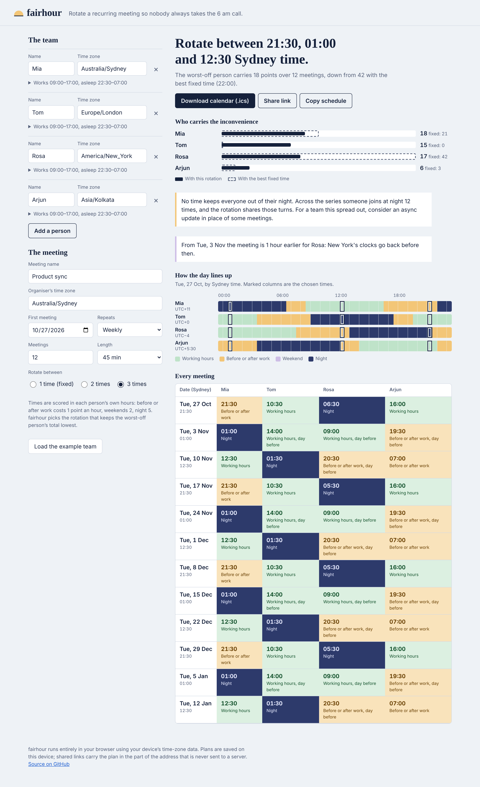
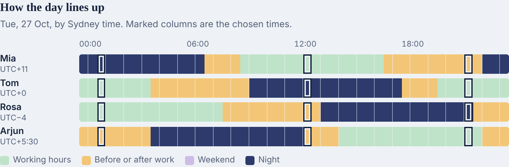
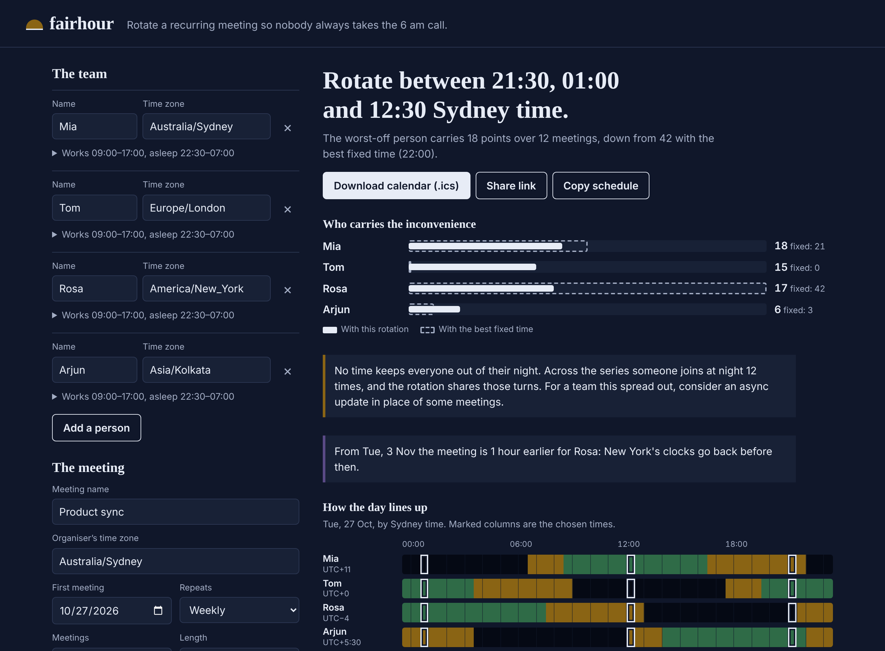
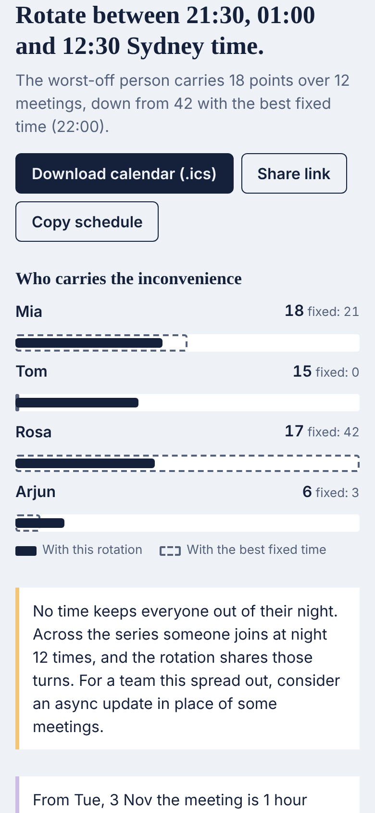

# fairhour

**Plan a recurring meeting across time zones that rotates fairly, so nobody always takes the 6 am call.** fairhour scores every possible start time on every actual meeting date (daylight-saving changes included) against each person's own working hours and sleep, then finds the fixed time or 2–3-slot rotation that keeps the *worst-off* person's total inconvenience as low as possible. Export the whole series to your calendar in one file.



## The problem

Distributed teams usually pick one meeting time and keep it. For teams spread across Australia, Asia, Europe and the Americas, that quietly means the same person joins at 6 am or 10 pm every week. Existing meeting planners are good at the single-meeting question ("when is everyone awake?") and some score the inconvenience of each slot. Rotation, sharing the bad slots across a whole series, is usually left as advice to do by hand, and daylight-saving changes in the middle of a series shift everyone's local times without warning.

fairhour treats the **series** as the unit:

- It scores each candidate time on the real date of every meeting, so the weeks after London, New York or Sydney change their clocks are counted correctly.
- It compares the best fixed time with the best rotation and tells you what rotating gains ("the worst-off person carries 18 points, down from 42").
- It tells you when there's simply no humane time (someone will be up at night) instead of hiding it.

## Features

- **Fair rotation search**: tries every combination of 1, 2 or 3 start times (in half-hour steps) and every starting order, and picks the one with the lowest maximum per-person inconvenience, then the lowest total.
- **Per-person hours**: each person sets work hours and sleep hours; weekends are their own local weekend (Friday afternoon in New York is Saturday morning in Sydney).
- **Daylight-saving aware**: candidate times are wall-clock times in the organiser's zone on each date; local times for everyone else are computed from the browser's IANA time-zone data. Nonexistent times (spring-forward gaps) and repeated times (fall-back overlaps) are handled explicitly.
- **DST notices**: "From Tue 3 Nov the meeting is 1 hour earlier for Rosa: New York's clocks go back before then."
- **Overlap chart**: every person's day as half-hour bands aligned to the organiser's clock, with the chosen times marked.
- **Schedule table** for every meeting with each person's local time and day.
- **Calendar export**: one `.ics` file with each meeting as its own event in UTC (a rotation can't be expressed as one repeating rule).
- **Share link and copy-as-text**; plans are saved on your device.
- **No dependencies, no build, no server.** Plain JavaScript modules, light and dark themes, works on phones.



| Dark mode | Phone |
|---|---|
|  |  |

## How fairness is scored

Each meeting is cut into 15-minute pieces in each person's local time:

| Local time | Points per hour |
|---|---|
| Working hours on a weekday | 0 |
| Before or after work | 1 |
| Weekend daytime | 2 |
| Night (between bedtime and waking) | 5 |

A person's total is the sum over the series. fairhour minimises the **largest** total (so the burden is shared), then the group total, then the gap between the most and least burdened people. Night is weighted heavily, so the planner only uses night slots when no other time exists; when that happens it says so.

The weights are a deliberate, simple model. They are documented here so you can judge the result rather than trust a black box.

## Run it

Prerequisites: any modern browser. For tests, Node.js 20+ and (for the browser tests) Python 3.10+.

fairhour is static files with ES modules, so it needs to be served over HTTP (browsers block modules from `file://`):

```bash
git clone https://github.com/iamnarace/fairhour.git
cd fairhour
python3 -m http.server 8000      # or: npx serve .
# open http://localhost:8000
```

There is nothing to install or build. To host it, upload the folder to any static host (GitHub Pages, Netlify, an S3 bucket).

## Use it

1. Add each person with their IANA time zone (the field suggests zones as you type) and, if needed, their working and sleeping hours.
2. Set the organiser's time zone, the first meeting date, how often it repeats, how many meetings, and the length.
3. Choose whether to keep one fixed time or rotate between 2 or 3 times.
4. Read the recommendation, check the schedule, then **Download calendar (.ics)**, **Share link** or **Copy schedule**.

## Tests

```bash
npm test                 # unit tests: node --test (time zones, scoring, planning, .ics, links)
npm run test:e2e         # browser tests: needs `pip install playwright && playwright install chromium`
```

The unit tests check real 2026 daylight-saving transitions (Sydney 4 Oct, London 25 Oct, New York 1 Nov), every half-hour of a transition week in five zones (including Chatham's +12:45), iCalendar escaping and 75-octet line folding, and validation of tampered share links. The browser tests drive the actual page: the example plan, editing the team, an invalid time zone, persistence, opening a shared link, the `.ics` download, and no sideways scrolling on a phone.

`npm` here only runs scripts; there are no packages to install. Screenshots are regenerated with `python3 scripts/screenshots.py`.

## Project structure

```
index.html          page shell
src/tz.js           wall time <-> UTC on top of Intl, DST gaps and overlaps
src/cost.js         the inconvenience model
src/plan.js         series building, rotation search, DST change detection
src/ics.js          RFC 5545 calendar export
src/state.js        inputs, validation, share-link format
src/app.js, dom.js  the interface (DOM built with textContent only)
src/styles.css
test/*.test.js      node:test unit tests
test/e2e.py         Playwright browser tests
```

## Privacy and security

- Everything runs in your browser. There is no server, no analytics and no third-party request: fonts are system fonts and time-zone data comes from your browser.
- Plans are saved in your browser's local storage. Share links carry the plan in the URL fragment (`#plan=…`), which browsers do not send to servers, but anyone you send the link to can read it.
- Shared links are validated field by field before use; unknown fields are dropped. Names are rendered as text, never as HTML.

## Known limitations

- The inconvenience weights are fixed (0/1/2/5); they are not yet adjustable in the interface.
- Weekends are Saturday and Sunday for everyone; regions with a Friday–Saturday weekend aren't modelled yet.
- Public holidays aren't considered.
- The search covers half-hour start times and up to 3 rotating slots and 52 meetings, which keeps it under a second on a phone.
- Time-zone accuracy depends on the browser's built-in IANA data, which browsers update with their releases.
- No hosted demo yet; run it locally as shown above.

## Roadmap

- Adjustable weights and per-person "never before/after" limits.
- Configurable weekends and optional public-holiday calendars.
- Constraints such as "the organiser must attend in working hours".
- A hosted copy on GitHub Pages.

## Contributing

See [CONTRIBUTING.md](CONTRIBUTING.md). Security reports: [SECURITY.md](SECURITY.md).

## Research

Background, comparable tools and design decisions are in [docs/RESEARCH.md](docs/RESEARCH.md).

## Licence

[MIT](LICENSE) © 2026 Naresh Adhikari.

Developed with assistance from Claude.
